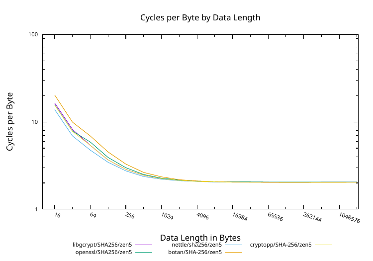

# bench-slopes

Bench-slopes is simple framework for benchmarking algorithm implementations in different
cryptographic libraries. "bench-slope" tool was
[originally introduced](https://github.com/gpg/libgcrypt/blob/master/tests/bench-slope.c)
as part of libgcrypt library testing suite. This repository extends bench-slope for use with other crypto
libraries.

Repository currently has support for following libraries:

- libgcrypt library, https://gnupg.org/software/libgcrypt/index.html
- OpenSSL library, https://www.openssl.org/
- nettle library, https://www.lysator.liu.se/~nisse/nettle/
- Botan library, https://botan.randombit.net/
- Crypto++ Library, https://www.cryptopp.com/

## How it works

Benchmark measures speed of algorithm for different input sizes 16, 80, 144, ..., 4112 (64 byte steps).
From these data points, 'time per byte' slope is calculated. Since the 'time per byte' result
is taken this way, any call overhead is eliminated from the result. Therefore results are close to
'time/cycle per byte for large buffer' benchmarks seen in other benchmarking tools.

# Building

## Prerequisites

Following packages are needed for building on Ubuntu 26.04: "autoconf automake pkg-config make gcc g++
libgcrypt20-dev libssl-dev nettle-dev libcrypto++-dev libbotan-3-dev".

Package names maybe different on other distributions. Botan 3 requires a C++20 compiler; Botan 2
is also supported. Libraries that are not found are skipped: configure prints a warning and
the corresponding program is built as a stub that only reports the missing library.

With OpenSSL 3, legacy algorithms (Blowfish, CAST5, IDEA, RC4, MD4, Whirlpool, etc.) are
benchmarked only if the OpenSSL legacy provider module is installed.

## Compiling

```
$ ./autogen.sh
$ cd build/
build/ $ ../configure
build/ $ make
```

'autogen.sh' generates the configure script and creates the 'build' directory.

## Build binaries

For each configured crypto-library, one bench-slope program is build
in to 'build/src/' directory. These are:

- bench-slope-gcrypt
- bench-slope-openssl
- bench-slope-nettle
- bench-slope-botan
- bench-slope-cryptopp

## Compiling directly with external library

Each program can be compiled also directly. For example:
```
$ gcc -O2 -DHAVE_CLOCK_GETTIME -DHAVE_LIBGCRYPT_1_8 -DHAVE_LIBGCRYPT_1_9 -DHAVE_LIBGCRYPT_1_10 \
    src/slope.c src/bench-slope-gcrypt.c -o bench-slope -lgcrypt -lgpg-error
$ ./bench-slope
bench-slope-gcrypt: libgcrypt: 1.12.0
...
```

Without config.h, the HAVE_LIBGCRYPT_1_x defines enable benchmarks for cipher modes added in
the respective libgcrypt versions (XTS, EAX, SIV and GCM-SIV). Leave out the ones newer than the
installed libgcrypt.

# Command-line options for bench-slope programs

Command-line help can be shown for each program with --help option:
```
$ src/bench-slope-gcrypt --help
bench-slope-gcrypt: libgcrypt: 1.12.0
usage: bench-slope-gcrypt [options] [hash|mac|cipher|kdf]

 options:
   --cpu-mhz <mhz>           Set CPU speed for calculating cycles
                             per bytes results.  Set as "auto"
                             for auto-detection of CPU speed.
   --repetitions <n>         Use N repetitions (default 64)
   --unaligned               Use unaligned input buffers.
   --csv                     Use CSV output format
   --raw                     Output raw benchmark data in CSV output format
   --machine <name>          Machine name used for raw benchmark files
```

Benchmark groups 'hash' and 'cipher' are available in all programs. 'mac' and 'kdf' are
available only in bench-slope-gcrypt.

# Running benchmarks

## All algorithms

Without any command-line options, each program runs benchmarks for all algorithms.

For example, following runs all benchmarks for OpenSSL:
```
$ src/bench-slope-openssl
bench-slope-openssl: OpenSSL 3.5.5 27 Jan 2026
Hash:
                |  nanosecs/byte   mebibytes/sec   cycles/byte
 MD4            |     0.498 ns/B    1914.1 MiB/s         - c/B
 MD5            |     0.820 ns/B    1163.6 MiB/s         - c/B
 BLAKE2b512     |     0.531 ns/B    1796.9 MiB/s         - c/B
 BLAKE2s256     |     0.894 ns/B    1066.4 MiB/s         - c/B
...
 SM3            |      1.47 ns/B     649.0 MiB/s         - c/B
                =
Cipher:
 des-ede3       |  nanosecs/byte   mebibytes/sec   cycles/byte
        ECB enc |     19.40 ns/B     49.15 MiB/s         - c/B
        ECB dec |     19.35 ns/B     49.29 MiB/s         - c/B
        CBC enc |     20.48 ns/B     46.58 MiB/s         - c/B
        CBC dec |     19.52 ns/B     48.85 MiB/s         - c/B
...
```

## Specific algorithms

Benchmarks can be limited to specific groups (such as 'hash', 'cipher', etc) and
to specific algorithms.

For example, running only cipher algorithm benchmarks on nettle:
```
$ src/bench-slope-nettle cipher
bench-slope-nettle: Nettle 3.10
Cipher:
 aes128         |  nanosecs/byte   mebibytes/sec   cycles/byte
        ECB enc |     0.058 ns/B   16472.9 MiB/s         - c/B
        ECB dec |     0.058 ns/B   16482.7 MiB/s         - c/B
        CBC enc |     0.498 ns/B    1915.5 MiB/s         - c/B
        CBC dec |     0.074 ns/B   12876.4 MiB/s         - c/B
        CFB enc |     0.697 ns/B    1367.3 MiB/s         - c/B
...
```

For example, running SHA1 and SHA512 benchmarks on OpenSSL:
```
$ src/bench-slope-openssl hash sha1 sha512
bench-slope-openssl: OpenSSL 3.5.5 27 Jan 2026
Hash:
                |  nanosecs/byte   mebibytes/sec   cycles/byte
 SHA1           |     0.349 ns/B    2733.0 MiB/s         - c/B
 SHA512         |     0.636 ns/B    1499.8 MiB/s         - c/B
                =
```

## CPU Mhz and 'cycles per byte' results, --cpu-mhz <mhz>

If you know clock frequency of the CPU on which benchmarks are run, you can supply
CPU Mhz value with '--cpu-mhz &lt;mhz&gt;' option. With help of this information, bench-slope
will be able to calculate 'cycles per byte' metric for each algorithm.

Approach of giving fixed &lt;mhz&gt; only works on CPUs with fixed CPU frequency. For CPUs
with dynamic frequency scaling, you can try '--cpu-mhz auto' setting. With auto-setting
bench-slope attempts to detect CPU frequency at the time of each algorithm is run and
use this detected frequency to generate 'cycles per byte' metrics.

On Linux, the frequency is measured with the hardware cycle counter (perf_event), which
requires 'kernel.perf_event_paranoid' to be 2 or lower, or CAP_PERFMON. The counter is read during the
benchmark itself, so the result reflects the clock while the algorithm runs, which can
be lower than usual under heavy vector instruction load. On IBM Z (s390x), the fixed CPU
frequency reported by the kernel is used if the cycle counter is not available.

Otherwise, the frequency is estimated from a loop of dependent arithmetic instructions,
assuming each of them takes one cycle. This is accurate on x86 and ARM, but not on POWER
and IBM Z, where these instructions take more than one cycle. bench-slope prints a warning
when falling back to this method on those architectures.

Running Crypto++ benchmarks on CPU with fixed frequency of 5.5 Ghz:
```
$ src/bench-slope-cryptopp --cpu-mhz 5500 hash CRC32 MD5
bench-slope-cryptopp: Crypto++ 8.9.0
Hash:
                |  nanosecs/byte   mebibytes/sec   cycles/byte
 CRC32          |      1.31 ns/B     725.7 MiB/s      7.23 c/B
 MD5            |     0.950 ns/B    1003.7 MiB/s      5.23 c/B
                =
```

Running libgcrypt benchmarks on CPU with dynamic frequency with auto-detection:

```
$ src/bench-slope-gcrypt --cpu-mhz auto hash sha1 ripemd160
bench-slope-gcrypt: libgcrypt: 1.12.0
Hash:
                |  nanosecs/byte   mebibytes/sec   cycles/byte  auto Mhz
 SHA1           |     0.347 ns/B    2744.8 MiB/s      1.92 c/B    5515.3
 RIPEMD160      |      1.16 ns/B     822.0 MiB/s      6.40 c/B    5519.6±0.1
                =
```

The '±' value is the estimated error of the detected frequency in Mhz. With the cycle
counter, it is the standard error of the frequency fitted over the measurement; otherwise,
it shows how much the frequency changed between detections before and after the
measurement.

## Number of repetitions, --repetitions <n>

Number of repetitions option controls accuracy and time which benchmarks
take to run. Higher number of repetitions generally give more accurate and
repeatable results at expense of greater run time for benchmark.

## Unaligned benchmarking, --unaligned

Unaligned option makes all input buffers to algorithms unaligned. This
allows benchmarking effect of unaligned input to algorithms.

## CSV output, --csv

CSV output option allows outputting benchmarking data in machine friendly
format.

For example:

```
$ src/bench-slope-gcrypt --cpu-mhz auto --csv hash sha1 ripemd160
bench-slope-gcrypt: libgcrypt: 1.12.0
hash,SHA1,,,,0.348,ns/B,2739.5,MiB/s,1.92,c/B,5525.4,Mhz,0.2,Mhz-diff
hash,RIPEMD160,,,,1.15,ns/B,827.3,MiB/s,6.36,c/B,5519.6,Mhz,0.4,Mhz-diff
```

## Raw data mode, --raw

Raw mode does not calculate a slope. Instead it measures each algorithm at input sizes
16, 32, 64, ..., 2097152 bytes (doubling) and writes the measurements to a CSV file per
algorithm and mode in the current directory. This shows how performance depends on input
length, for example the effect of call overhead on short inputs.

Raw mode requires '--cpu-mhz' (a fixed value or 'auto') and cannot be combined with '--csv'.
The 'kdf' group is skipped in raw mode.

Files are named `<library>_results_for_<group>_<algorithm>_<mode>_on_<machine>.csv`,
with '/', '\\' and space characters replaced by '-'. Each line has three columns: input
length in bytes, cycles for processing the input, and cycles per byte.

```
$ src/bench-slope-gcrypt --raw --cpu-mhz auto --machine desktop hash sha256
bench-slope-gcrypt: libgcrypt: 1.12.0
Writing results to file "libgcrypt_results_for_hash_SHA256__on_desktop.csv"...
$ cat libgcrypt_results_for_hash_SHA256__on_desktop.csv
16,262,16.39
32,262,8.20
64,345,5.39
128,469,3.67
...
1048576,2133570,2.03
2097152,4277740,2.04
```

### Plotting raw results

'plot_raw_results.sh' (built to 'build/src/') plots raw result files into PDF files using
gnuplot. Run it in the directory containing the CSV files, for example after collecting raw
results from several libraries and machines into one directory. The script requires bash and
gnuplot.

The script covers a predefined set of common algorithms (AES, Camellia, ChaCha20, SHA-2, etc.).
For each algorithm and mode, results of all libraries and machines are combined into one PDF
file, for example `results_cipher_AES128-CBC.pdf`, with three plots by input length: speed
in MiB/s scaled to a 2 Ghz CPU, absolute cycles, and cycles per byte.

Example 'cycles per byte' plot of SHA-256 raw results from all five libraries on AMD Ryzen 9 9950X3D
(results collected with '--raw --cpu-mhz auto --machine zen5 hash sha256', or 'SHA-256' for
Botan and Crypto++):



## Machine name, --machine <name>

Sets the machine name used in raw mode file names (`_on_<machine>.csv`), so that
results from different machines can be stored in the same directory and plotted together.

# License

GNU Lesser General Public License v2.1 or later

see: [LICENSE file](LICENSE)
